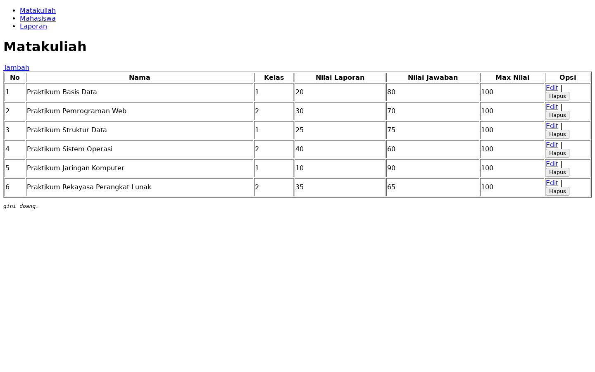
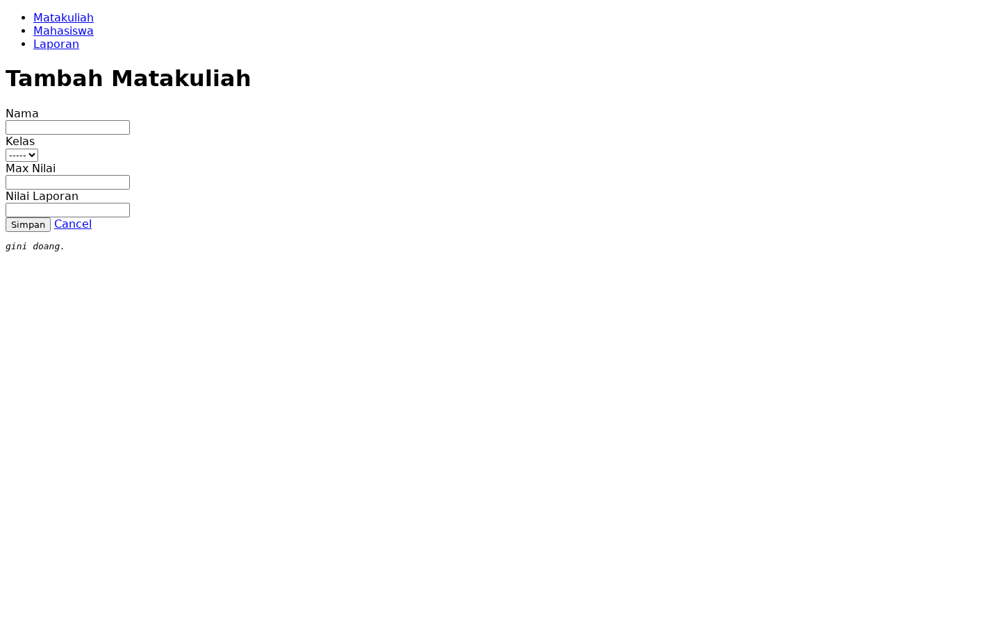
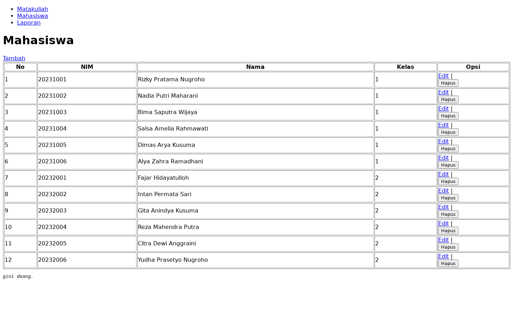
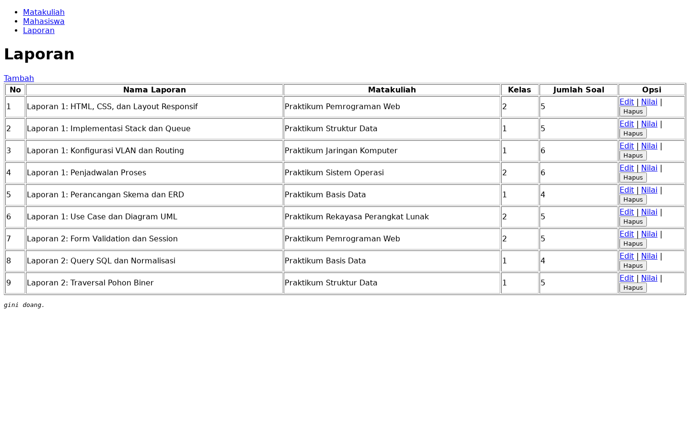

# Asdos Menilai

A grading tool for teaching assistants (asdos) who mark lab (praktikum) courses. It keeps the three things an asdos juggles — courses (matakuliah), students (mahasiswa), and each lab report (laporan) — in one place, then records a grade for every student on every report.

The assistant marks question by question instead of maintaining a spreadsheet: each answer is Salah, Benar, or Optional, and the app computes the final grade. Students are grouped by class (kelas 1 or 2), and the grade form only offers students from the report's class.



## What you can do

- Add, edit, and remove `matakuliah` courses, setting the class and how the report score is split from the question score.



- Keep the `mahasiswa` roster — NIM, name, and class — for the students you grade.



- Set up each `laporan` against a course and state how many questions it has.



- Score a student's report question by question as Salah, Benar, or Optional; the app applies each question's weight and saves the result.
- Add a student on the fly while entering a grade: an unmatched NIM becomes a new `mahasiswa` row.
- Open a report's gradebook to see every student's computed grade in one table.
- Correct or delete a grade afterwards when a score was entered wrong.

The three links in the header — Matakuliah, Mahasiswa, Laporan — are the whole navigation. Grades live one click deeper, on the Nilai link of a report; that per-question grade form is the one screen not pictured here.

## How grades are calculated

A course sets two numbers: `max_nilai`, the maximum total, and `nilai_laporan`, the part awarded for the report itself. The rest is spread evenly across the report's questions, so each question's weight (`bobot`) is `(max_nilai - nilai_laporan) / jumlah_soal`. The grade form renders one row per question.

Salah scores zero, Benar scores the full weight, and Optional takes a value entered by hand. The saved grade is `nilai_jawaban` (the sum of the question scores) plus `nilai_laporan`, shown in the report's gradebook.

Neither the weight nor that final total is stored as an editable field; both are computed when the pages render. The grade row itself keeps only the per-question answers and the report-score portion.

## How it works

Pages are rendered server-side with Blade. nginx serves the built static assets and passes PHP requests to PHP-FPM over a local socket; the shipped image exposes port 8080. The image is assembled in four stages — a Composer binary stage, a vendor stage, a Node asset stage, and a PHP-FPM runtime running nginx under a process supervisor.

Courses, students, and reports are stored and edited independently. A grade is the only record that joins a student to a report, and it does so by matching `kelas` rather than a stored relationship.

There is no account system and no dashboard; the landing route simply redirects to the course list.

## Running it

```sh
composer install
npm install
npm run build
php artisan db:seed --class=DemoContentSeeder
```

Seeding loads the shipped demo content — six courses, twelve students, nine reports, and fifty-four grades — so the screens above show real rows. The demo data lives in `database/seeders/DemoContentSeeder.php`.

The seeded courses are the six praktikum names shown in the first screenshot.

The migrations are committed and must be applied before a fresh database is seeded. The code defaults to MySQL, while this workspace runs PostgreSQL (`asdos-menilai-db`) selected through `DB_CONNECTION`. The build and smoke commands for the container are in `CONTAINERIZE.md`.

## Limitations

- There is no login. All 25 web routes, including grade entry and deletion, are reachable by anyone who has the URL.
- Controllers catch an undefined `err` class, so real failures surface as 500 errors instead of the intended "Gagal" message.
- A report with zero questions divides by zero when computing each question's weight; the create form sets no minimum on the question count.
- The grade forms depend on jQuery from a public CDN and lose their dropdown behaviour if that host is unreachable.
- Sessions and cache are stored in files inside the container, so they do not survive a restart or work across multiple replicas.
- The records are thin: a course has no semester or SKS, and a report has no due date or status.

Developer notes, exact versions, the data model, and operational risks are in [TECHNICAL.md](TECHNICAL.md).
